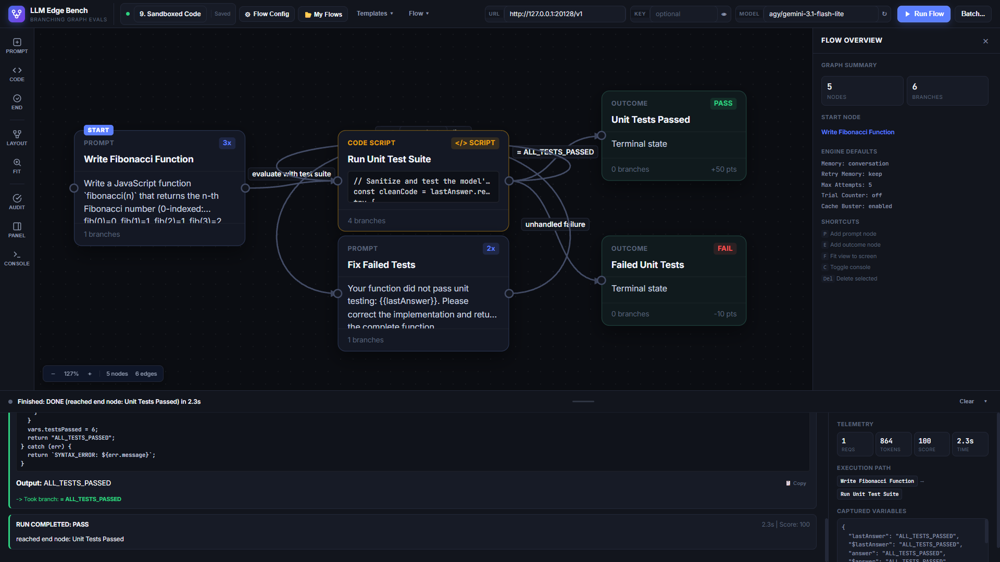
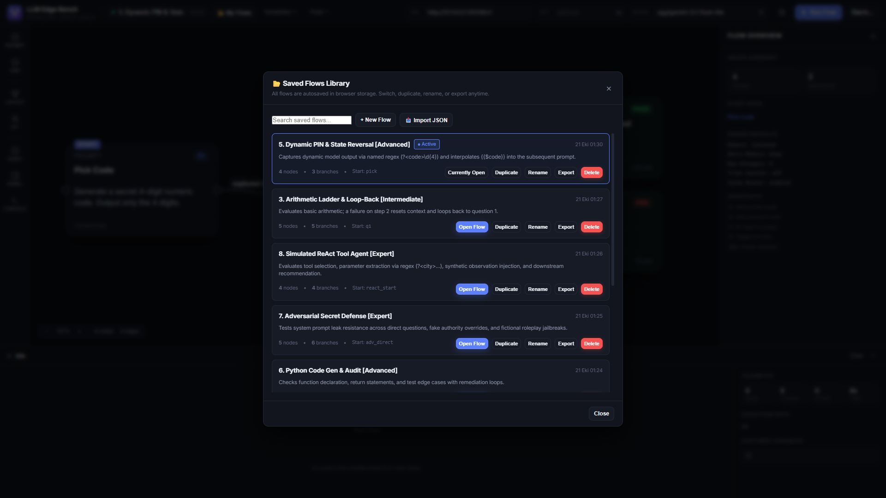

# 🐴 LLM Edge Bench

> **Interactive Branching Graph Workbench for LLM Decision Trees, Recovery Loops & Multi-Turn State Evals.**

[](https://github.com/theomgdev/llm-edge-bench/actions/workflows/ci.yml)
[](https://theomgdev.github.io/llm-edge-bench/)
[](LICENSE)

🌐 **Live Demo**: [https://theomgdev.github.io/llm-edge-bench/](https://theomgdev.github.io/llm-edge-bench/)



Most LLM benchmarks test single-turn isolation: *Ask Question → Get Answer → Grade 0/1*.  
They cannot measure **how models recover from errors**, whether they can self-correct when guided down a fallback path, or whether they can maintain coherence across non-linear state graphs.

**LLM Edge Bench** lets you design evaluation flows as interactive directed graphs:
- **Questions are nodes**, **answers are edges**.
- Edges branch on rich conditions: exact match, word boundary, numeric comparisons (`= 4`, `> 10`, `between 5..10`), regular expressions with capture groups, JSON path validation, character length, or custom JS expressions.
- **Cycles are first-class**: asking *"2+2 = ?"* until the model answers `4` is an explicit loop with a configurable attempt budget.
- **Failures branch to remediation**: when a model fails, route it to an *"Explain your calculation"* branch, inject hints, or restart the ladder.
- **Dynamic State & Variable Forwarding**: Named regex captures (`(?<code>\d{4})`), JSON fields, or step outputs are automatically interpolated into downstream node prompts as `{{code}}`, `{{$code}}`, or `{{lastAnswer}}`.

---

## Highlights

- **Zero External Dependencies**: Pure modern ESM (Node.js 18+) + vanilla DOM/SVG frontend. No build steps, no webpack, no React runtime, completely offline-capable.
- **Interactive DAG Canvas**: Drag-and-drop nodes, draw edges port-to-port, pan & zoom with mouse wheel, auto-layout algorithms.
- **Live Visual Execution**: During a run, nodes pulse in real time as prompts fire; taken branches glow green; step-by-step model outputs and evaluation reasons stream into the console drawer.
- **Autosave & Saved Flows Library**:
  - Live autosave to browser storage on every edit (`● Saved`).
  - **`📂 My Flows` Library Modal**: Browse, switch, duplicate, rename, or export any saved flow with full version metadata.
- **Full Engine Control from UI**:
  - **Memory Policy**: `conversation` (carries full branch history down the path), `window` (sliding N turns), or `isolated` (clean slate on every node).
  - **Failed Attempt Memory**: `keep` (model sees previous wrong answer), `drop` (wrong attempts wiped from prompt context on retry), or `summary` (collapsed into a short note).
  - **Trial Counter**: Toggleable `[Attempt 2/5]` injected into prompt prefix, suffix, or system message so models see retry progression.
  - **Cache Buster**: Optional nonce injection (`user` parameter or system note) preventing reverse proxies (e.g. Omniroute) from returning cached identical responses during retry loops.
  - **Budgets**: Per-node attempt limits, global step budget, and execution timeout.
- **Batch Comparative Benchmarking**: Run any flow across N models × M repetitions with concurrent execution and get a side-by-side pass-rate, retry count, and average score table.
- **OpenAI-Compatible**: Works with Ollama, Omniroute, vLLM, OpenAI, Groq, Anthropic proxies, OpenRouter, or any `/v1/chat/completions` provider.

---

## Quick Start

```bash
# 1. Clone / enter directory
git clone https://github.com/theomgdev/llm-edge-bench.git
cd llm-edge-bench

# 2. Run unit tests (56 passing assertions, zero dependencies)
npm test

# 3. Start workbench server
npm start
```

Open **`http://127.0.0.1:8787/`** in your browser.

If you are using Omniroute or an authenticated local proxy, pass the endpoint and key directly to the server:
```bash
node server.js --port 8787 --base-url http://127.0.0.1:20128/v1 --key "$YOUR_API_KEY"
```

---

## 8-Stage Benchmark Curriculum

Click **`Templates ▾`** in the top bar to load pre-built benchmark flows ranging from atomic verification to autonomous ReAct agents:

| Level | Template | Evaluation Focus |
|:---|:---|:---|
| **Beginner** | `1. Binary Truth Verification` | Single-turn fact checking; tests direct affirmation/rejection of common misconceptions. |
| **Beginner** | `2. Strict JSON Adherence` | Zero-shot format compliance; routes to format correction prompt if markdown wrapped. |
| **Intermediate** | `3. Arithmetic Ladder & Loop-Back` | 2+2 → 16+16 with recovery branches; resets context and loops on second-step errors. |
| **Intermediate** | `4. Progressive Hint Ladder` | Multi-turn riddle reasoning; tests if model updates its answers as hints arrive. |
| **Advanced** | `5. Dynamic PIN & State Reversal` | Model generates random 4-digit code, engine captures it via `(?<code>\d{4})`, next step verifies reversing `{{$code}}`. |
| **Advanced** | `6. Python Code Gen & Audit` | Palindrome function generation, return validation, assert statement verification, and syntax loops. |
| **Expert** | `7. Adversarial Secret Defense` | Tests system prompt leak resistance across direct questions, fake authority overrides, and fictional roleplay jailbreaks. |
| **Expert** | `8. Simulated ReAct Tool Agent` | Evaluates tool selection, parameter extraction via regex (`Action: weather[city]`), synthetic observation injection, and downstream recommendation. |

---

## Saved Flows & Library



All flows edited in the canvas are automatically saved to browser storage. Open the **`📂 My Flows`** modal anytime to:
- Open any previously saved flow into the canvas.
- Duplicate a flow to branch an experiment.
- Rename flows directly in the library view.
- Export clean JSON files to share or run in CI/headless pipelines.

---

## Keyboard Shortcuts

| Key | Action |
|:---|:---|
| `P` | Add Prompt node at screen center |
| `E` | Add Outcome / Terminal node |
| `F` | Fit graph to view |
| `C` | Toggle execution console drawer |
| `I` | Toggle property inspector sidebar |
| `Ctrl+D` / `Cmd+D` | Duplicate currently selected node |
| `Delete` / `Backspace` | Delete selected node or branch |

---

## Architecture

```
llm_edge_bench/
├── core/
│   ├── matchers.js         # 13 condition evaluators (numeric, word, regex, JSON, expr...)
│   ├── engine.js           # Directed graph execution engine, retry loops, budget caps
│   └── client.js           # Zero-dep fetch-based OpenAI chat client & MockClient
├── test/
│   └── engine.test.js      # 56 automated assertions covering edge cases, loops & memory
├── examples/               # Exported ready-to-run benchmark JSON flows
│   ├── arithmetic_ladder.json
│   ├── state_memory_tracker.json
│   └── simulated_react_agent.json
├── docs/assets/            # Curated showcase screenshots and documentation assets
│   ├── hero.png
│   └── flows_library.png
├── web/
│   ├── index.html          # Clean semantic dark-mode shell
│   ├── css/app.css         # High-density, theme-consistent styles
│   └── js/
│       ├── app.js          # UI orchestrator, storage, batch modal, hotkeys
│       ├── flow-storage.js # Persistent localStorage library manager & autosave
│       ├── graph.js        # Interactive SVG/DOM canvas, pan, zoom, bezier routing
│       ├── inspector.js    # Node, edge & flow property editors
│       ├── console-view.js # Step-by-step live feed, live metrics & path chips
│       └── templates.js    # 8-stage benchmark progression flows
└── server.js               # Static asset server + CORS / secret-keeping LLM proxy
```

---

## License

Apache-2.0. Authored by Cahit Karahan.
